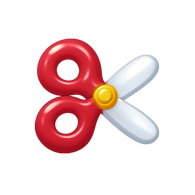
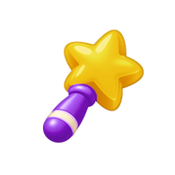
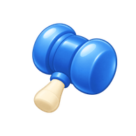
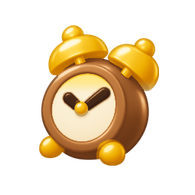
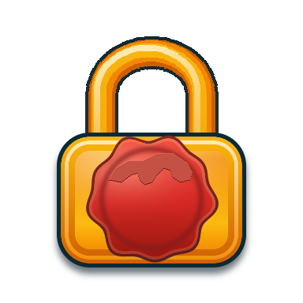

# HUD ve booster asset teslimi

Unity’nin kullandığı onaylı Task40 seti. Makas, değnek, çekiç ve saatte kontur yerine her malzemenin kendi koyu tonu kenarı oluşturuyor. Çekiç mavi ve saatin kahverengi kasası Task36 seçimine uyuyor.

| Önizleme | PNG | Renk ve malzeme | Boyut |
|---|---|---|---:|
|  | [Makas](../../../Assets/_Game/Presentation/Resources/Art/yeni/hud/scissors.png) | Kırmızı sap, açık çelik bıçak ve altın göbek. | 195×195 |
|  | [Değnek](../../../Assets/_Game/Presentation/Resources/Art/yeni/hud/wand.png) | Altın yıldız ve mor sap. | 195×195 |
|  | [Çekiç](../../../Assets/_Game/Presentation/Resources/Art/yeni/hud/hammer.png) | Doygun mavi baş ve krem sap. | 195×195 |
|  | [Saat](../../../Assets/_Game/Presentation/Resources/Art/yeni/hud/clock.png) | Kahverengi kasa, altın ziller ve krem kadran. | 195×195 |
|  | [Kont’un mührü](../../../Assets/_Game/Presentation/Resources/Art/yeni/obstacles_v3/padlock-b/closed.png) | Kırmızı balmumu ve altın kilit. | 384×384 |

## Katmanlı HUD

| Katman | Dosya | Boyut |
|---|---|---:|
| Lacivert → mavi üst şerit ve altın bordür | [top-strip.png](../../../Assets/_Game/Presentation/Resources/Art/yeni/hud/top-strip.png) | 1170×504 |
| Beş yuvalı alt şerit zemini | [bottom-strip.png](../../../Assets/_Game/Presentation/Resources/Art/yeni/hud/bottom-strip.png) | 1170×219 |
| Krem sayaç gövdesi ve iç çerçeve | [counter-panel.png](../../../Assets/_Game/Presentation/Resources/Art/yeni/hud/counter-panel.png) | 340×290 |
| Krem başlık ve lacivert flama | [header.png](../../../Assets/_Game/Presentation/Resources/Art/yeni/hud/header.png) | 364×166 |
| Jigo’nun kemerli penceresi | [portrait-window.png](../../../Assets/_Game/Presentation/Resources/Art/yeni/hud/portrait-window.png) | 388×367 |
| Tuş yuvası ve durdurma | [socket.png](../../../Assets/_Game/Presentation/Resources/Art/yeni/hud/socket.png), [settings-normal.png](../../../Assets/_Game/Presentation/Resources/Art/yeni/hud/settings-normal.png), [pause.png](../../../Assets/_Game/Presentation/Resources/Art/yeni/hud/pause.png) | 232×232, 232×232, 120×132 |

[Tuş durumları ve portre dizileri](../task40/FINAL_LISTE.md) · [Mührün açılma kareleri](../../../Assets/_Game/Presentation/Resources/Art/yeni/obstacles_v3/padlock-b/open-01.png) · [Balmumu parçaları](../../../Assets/_Game/Presentation/Resources/Art/yeni/obstacles_v3/padlock-b/wax-01.png)

## Kontrol

Beş ikonun RGBA kanalı ve şeffaf kenarları okundu. 195×195 booster tuvallerindeki görünür şekiller 118–130 px genişlikte ve 120–145 px yükseklikte. İkonların yerleşimi Unity’de yeşil disk üzerinden ayarlanıyor. Kont mührünün görünür altın ve mum bölgesi 260×311 px.

Unity Play Mode’da bir engelli bölüm aç. Çekicin mavi başını, dört booster siluetini, beşinci Durdur yuvasını ve kilit sayısı sıfıra indiğinde mumun dağılmasını kontrol et.
