# PM_74 gece raporu: oyunu cilala (16 Kasım 2026)

**Oyna (p23):**
- Test: https://zeydusht.github.io/reverse-solver-unity/p23/?c=p23&test=1&lang=tr
- Sıfırdan oyuncu: https://zeydusht.github.io/reverse-solver-unity/p23/?c=p23&reset=1&lang=tr

p22, p21, p20, kök ve pt1'e dokunulmadı. Denetim listesi: [DENETIM.md](DENETIM.md) (27 madde, önce görüntüleri `once/`).

## Kısaca
- **Değnek hatası:** test linkinde booster dersinden sonra oyunun donması düzeldi. Hata dört booster dersinde de vardı. Tahtanın dışına tek dokunuş artık seçimi iptal ediyor.
- **Yerleşim:** tahta ekran kenarından ve HUD'dan ayrıldı. Jigo kemerin içinde, göz kırpması 3–6 saniyede bir. Parça kutusunda yalnız sayı var. Menüde tek "Oyna · Bölüm N" düğmesi kaldı.
- **Booster'lar ve saat:**
  - Codex çizdi (en yüksek düşünme ayarı, `xhigh`).
  - Her booster için üç fikir oyuna kondu ve 390×844 GIF'le puanlandı.
  - Varsayılanlar: çekiçte uçup vurma, makasta gel-açıl-"şak", değnekte daire çizip girdap, saatte uçup kutuya konan çalar saat ve altında "+10 sn" rozeti.
- **Resme dalma geçişi:**
  - Menüden bölüme: kamera tablonun içine dalar, tahta resimden çıkar, HUD en son kayar (≈ 0,95 sn).
  - Kazanmadan sonrakine: biten resim sola asılır, yenisi gelir, ona dalınır (≈ 1 sn).
- **Cila:**
  - Kaybetme ve devam ekranları kazanma ekranının dilinde: kartsız, ışık, kabartma başlık, büyük Jigo.
  - İsim ekranı onaylı tarzda: krem panel, mavi çerçeve, kurdele yok.
  - Diğerleri: "N hamle" ve "gövde" yazıları düzeldi, "Seviye" → "Bölüm", sandık sayacı HUD'dan ayrıldı, tık sesi kısıldı, Durdur yazıları büyüdü.

## Aşama 1: Hatalar
| Sorun | Sebep | Çözüm |
|---|---|---|
| Test linkinde değnekten sonra hiçbir şeye tıklanamıyor | Test modunda envanter yazılmasın diye konan koşul, ders adımının bitmesini de atlıyordu. "Booster'a dokun" adımı açık kalınca bütün dokunuşları yutuyordu. 5, 9, 15 ve 23. bölüm derslerinin hepsinde vardı. | Ders adımı her modda biter; test linkinde envanter yine yazılmaz, 999 stok aynı kalır. PlayMode testi: 9. ve 15. bölüm. |
| Seçimden çıkmak zor | Yalnız aynı booster'a yeniden dokununca kapanıyordu. | Tahtanın dışına (karartılmış alan, HUD, Durdur) tek dokunuş iptal eder. Ders sırasındaki rehberli seçim hariç. |
| 30. bölüm kartı "Kilitli parça **N hamle**…" | Kilitlerin sayıları farklı olunca metin "N" yazıyordu. | "üstündeki sayı kadar hamle" / "as many moves as its number" |
| Kaybetmede "35 gövde kaldı" | Eski terim | "35 parça kaldı" |
| "Seviye 40", "Sonraki Seviye", "Seviye 6'da açılır" | Menü "Bölüm" diyor | Hepsi "Bölüm" |

## Aşama 2: Yerleşim ve HUD
| | Önce | Sonra |
|---|---|---|
| Menü | 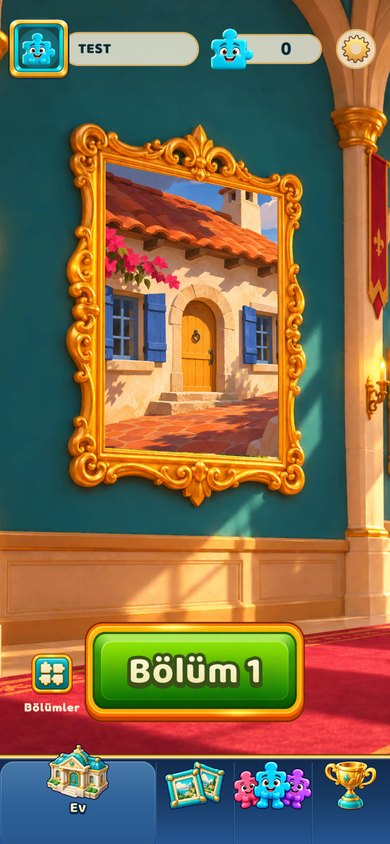 | 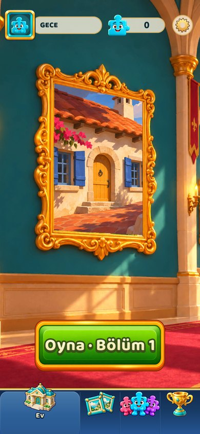 |
| HUD + tahta (20) | 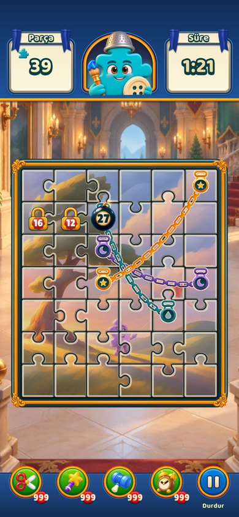 | 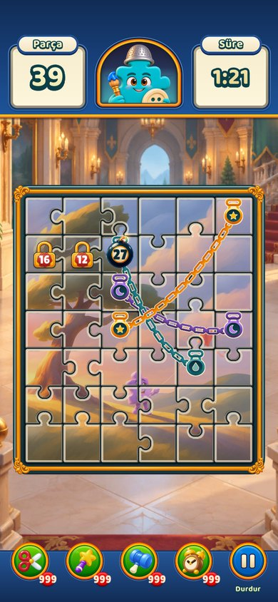 |
| 8 sütunlu tahta (40) | 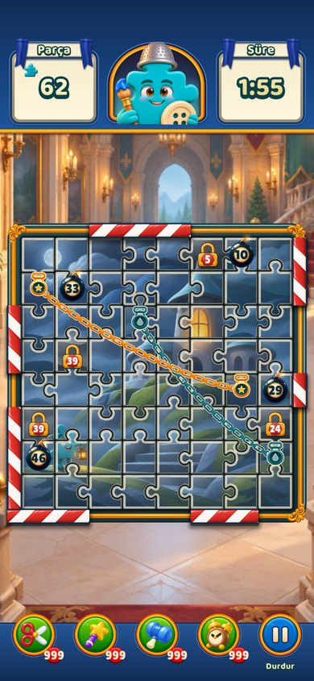 | 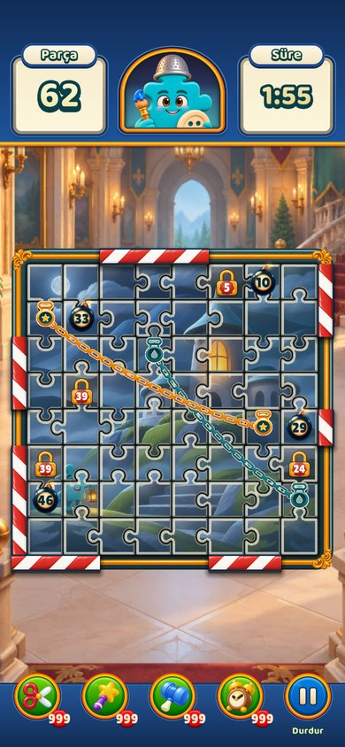 |

- **Tahta:**
  - Altın çerçevenin dışında her yanda en az 12 px hava var: 8 sütunda ~13 px, 6–7 sütunda ~16 px. HUD ve booster çubuğuyla arada da 12 px.
  - 8 sütunlu iki bölümde hücre 42 → 41 px oldu. 44 px'e o genişlikte sığmıyor; 7 sütuna kadar bütün tahtalarda ≥ 45 px.
- **Jigo:**
  - Kemerli açıklıkla kırpılıyor; yüksük kemerin 3 pt altında, düğme alttan kesiliyor.
  - Göz kırpma hissinin sebebi: açık göz kareleri saniyede 20 kez dönüyordu. Artık tek kare duruyor; kırpma 3–6 sn'de bir rastgele.
  - Nefes alma daha yumuşak.
  - Önce/sonra GIF: [jigo_goz_once_sonra.gif](jigo_goz_once_sonra.gif).
- **Parça kutusu:** ikon kalktı, sayı %30 büyük ve ortada.
- **Menü:** normal oyuncuda tek büyük "Oyna · Bölüm N". "Bölümler" düğmesi ve harita yalnız `&test=1`'de.

## Aşama 3: Booster'lar ve saat
Her biri için döngü:
1. Codex parçaları çizdi (`CODEX_PM74_SAAT.md`, `CODEX_PM74_EFEKT.md`; saat için 3 storyboard).
2. Üç fikir oyuna kondu ve 390×844'te kaydedildi.
3. Fikirler puanlandı; seçilen iki tur düzeltildi.

Ölçüt: tarz · anlaşılır · wow · temiz · süre/yumuşak bitiş (1–5). FPS PC'de 60 (iPhone'da ölçülmedi).

| Booster | Fikir | Puan | Süre | Durum |
|---|---|---|---|---|
| Çekiç | **A** uçar, geri kalkar, vurur: çatlak + sarsıntı + kıvılcım + kıymıklar | 5·5·4·5·5 | 1,05 sn | varsayılan |
| | B yukarıdan düşüp çakar | 5·4·5·5·5 | 0,85 sn | `&cekicfx=b` |
| | C iki vuruş (çatlar, sonra kırılır) | 5·4·4·5·4 | 1,2 sn | `&cekicfx=c` |
| Makas | **A** gelir, ağzı açılır, "şak", çıkıntı kopup uçar, dönerek çıkar | 5·5·4·5·5 | 1,15 sn | varsayılan |
| | B çıt çıt iki kesim | 5·4·4·5·4 | 1,2 sn | `&makasfx=b` |
| | C yandan hızla geçer | 5·3·3·5·5 | 0,8 sn | `&makasfx=c` |
| Değnek | **A** uçar, bölgenin etrafında daire çizer, girdap; parçalar kalkıp döner | 5·4·4·5·5 | 1,45 sn | varsayılan |
| | B üç dokunuş | 5·3·3·5·5 | 1,3 sn | `&degnekfx=b` |
| | C çapraz süpürme izi | 5·4·4·5·5 | 1,2 sn | `&degnekfx=c` |
| Saat | **A** çalar saat Süre kutusuna uçar, konup çalar, kutu buzlanır, "+10 sn" patlar ve rozete iner | 5·5·4·5·5 | 1,35 sn | varsayılan |
| | B büyük saat ibreleri geri sarar, kutuya dalar | 4·4·3·5·5 | 1,4 sn | `&saatfx=b` |
| | C saat değince buz dalgası | 5·5·5·5·5 | 1,15 sn | `&saatfx=c` |

GIF'ler `booster/` klasöründe:
- `*_once_sonra.gif`: eski | yeni varsayılan.
- `*_B.gif`, `*_C.gif`: diğer fikirler.
- `saat/fikir_A–C.png`: Codex'in storyboard'ları.
- Eski animasyonların hepsi `&fx=eski` ile açılır.

**Notlar:**
- **Makas:** zinciri değil, iki parça arasındaki yapboz çıkıntısını kesiyor. Bu yüzden "kopan halkalar" yerine kesilen çıkıntı (resmin renginde yapboz kıymığı) ve kırıntılar uçuyor. Codex'in zincir halkası çizimleri dosyada duruyor, kullanılmadı.
- **Saat:** kural değişmedi, süreyi 10 sn durduruyor. Durma süresi Süre kutusunun altındaki "+10 sn" rozetinde geri sayılıyor (Codex'in üç fikrinde de vardı).

## Aşama 4: Resme dalma geçişi
- **Menü → bölüm:**
  - Tabloya yakınlaşma 0,42 sn (ease-in), kısa krem ışık.
  - Kamera tahtanın resminden 0,38 sn'de geri çekilir (ease-out). Parçalar dağıtılmadan yerinde durur, resim yapboza dönüşür gibi görünür.
  - HUD ve booster çubuğu en son kayarak gelir. Toplam ≈ 0,95 sn.
- **Kazanma → Sonraki bölüm:** biten resim çerçevesiyle küçülüp sola "asılır", yeni tablo sağdan gelir (0,26 sn), içine dalınır (0,26 sn), bölüm aynı biçimde açılır. Toplam ≈ 1 sn.
- **Kapatma:** `&gecis=yok`. Dalış sırasında dokunuşlar yok sayılır.
- **İlk açılış donması giderildi:**
  - Ölçüm (`&perf=1`): oturumdaki ilk bölüm açılışında ~0,3 sn'lik tek bir uzun kare vardı. Kurulum ~0,2 sn; ardından ilk çizimde gölgelendirici ve doku hazırlığı. Resim çözme yalnız 30–50 ms.
  - Çözüm: menü kurulurken bir sonraki bölümün HUD, tahta ve çubuğu iki kare boyunca arka planın arkasında çizilip siliniyor (ısınma, `&isinma=0` kapatır).
  - Sonuç: ilk açılışta en uzun kare 32 ms. Dalış boyunca en kötü kare 58,5 FPS (PC).
- GIF'ler: [gecis/menu_dalis.gif](gecis/menu_dalis.gif), [gecis/sonraki_dalis.gif](gecis/sonraki_dalis.gif).

## Aşama 5: Genel cila
| | Önce | Sonra |
|---|---|---|
| İsim (ilk açılış) | 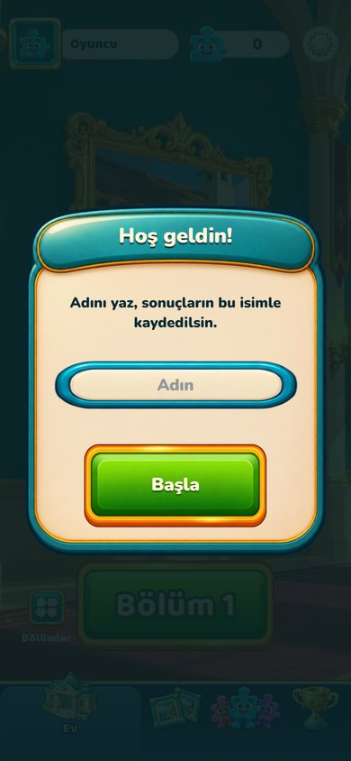 | 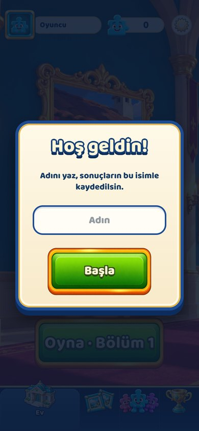 |
| Süre doldu (devam) | 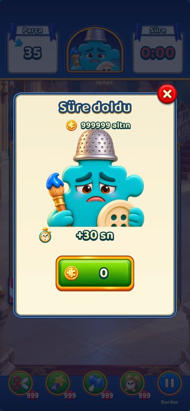 | 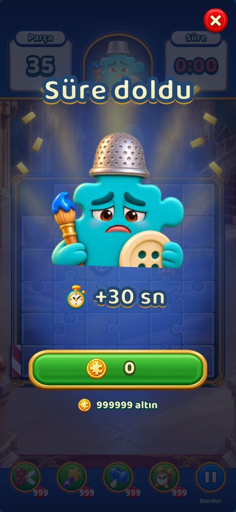 |
| Kaybetme | 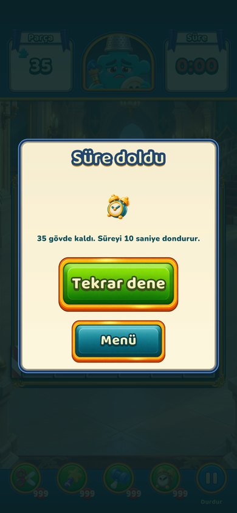 | 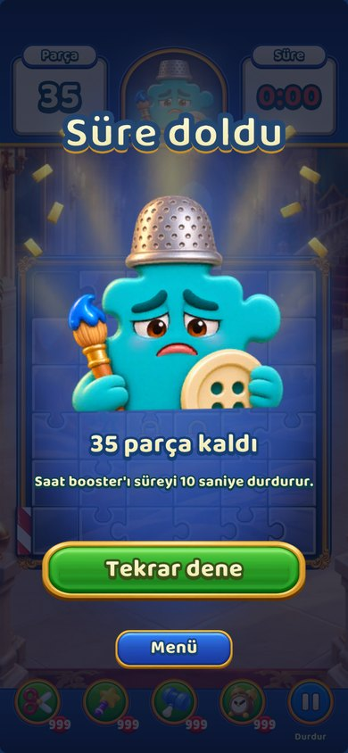 |
| Sandık | 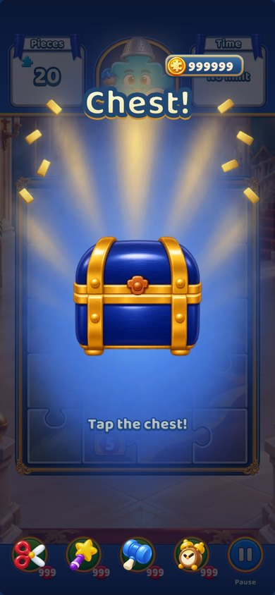 | 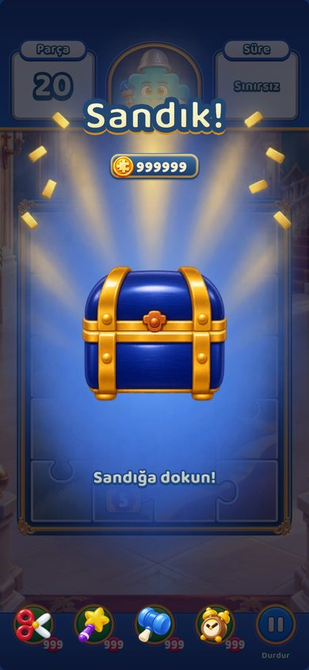 |
| Bölüm 30 kartı | 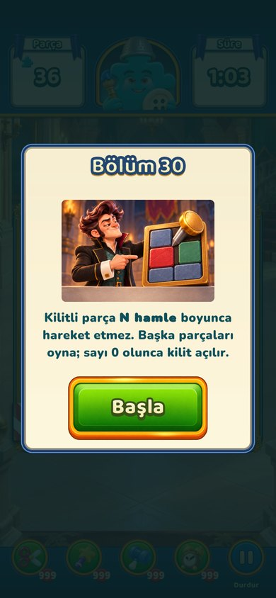 | 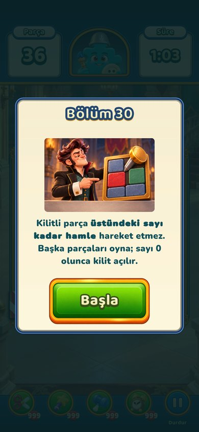 |

- **Kaybetme ve devam:**
  - Kazanma ekranının dili: kart yok, mavi ışık, kabartma başlık, üzgün Jigo (seyrek göz kırpar), tek satır yardım, büyük yeşil ve küçük mavi düğme.
  - Giriş 0,7 sn; dokununca hemen biter.
- **İsim ekranı:** krem panel, mavi çerçeve, altın iç çizgi, Baloo kabartma başlık, kurdele yok (Baloo alt kümesi 22 KB).
- **Diğerleri:**
  - Sandık: altın sayacı başlığın altına indi, Süre kutusuyla çakışmıyor.
  - Kazanma: "Menü" dokunma alanı ≥ 44 pt.
  - Ses: her çıkışta çalan tık −4 dB, bomba −1,5 dB.
  - Durdur: düğme yazıları 15 pt.
- **HUD başlıkları:** Parça/Süre başlıkları kurdelesiz krem hap + mavi kenar oldu (onaylı tarz). İkinci seçenek `&hud=lacivert`: lacivert hap + altın kenar. Eski kurdeleli başlık `&hud=kurdele` ile durur. Görüntüler: `sonra/bolum20.jpg`, `sonra/bolum20_hud_lacivert.jpg`.

## Zeyd'e kalan seçimler
1. **Booster fikirleri:** varsayılanlar A. B ve C linke `&cekicfx=b`, `&makasfx=c`, `&degnekfx=c`, `&saatfx=c` gibi eklenerek denenir. En güçlü alternatifler: saat C (buz dalgası) ve çekiç B (yukarıdan çakma).
2. **HUD başlıkları:** krem hap (varsayılan), lacivert hap (`&hud=lacivert`) ya da eski kurdeleli (`&hud=kurdele`).
3. **Saat kuralı:** "10 sn durdurur" mu, gerçekten "+10 sn ekler" mi? PM mesajı "süre eklendi" diyordu. Şimdilik kural aynı, görünüş "+10 sn".

## Doğrulanmadı
- **iPhone:** his, 60 FPS ve titreşim.
- **Dalış:** ilk açılışta resmin geç inmesi. Resim yoksa dalış atlanır, bölüm doğrudan açılır.
- **Isınma:** menüdeki ısınmanın iPhone'da menü açılışına eklediği süre.
