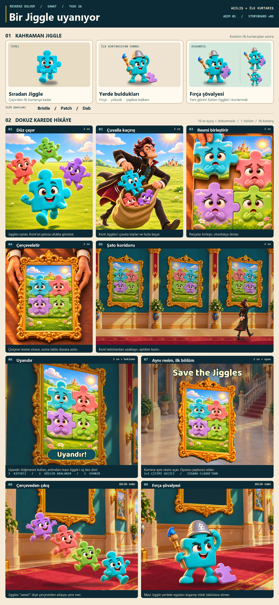

# Bir Jiggle uyanıyor

Task 26 · Adım 1 · Açılış ve ilk kurtarış · v03

## Kahraman Jiggle

Mavi Jiggle, açılıştan ilk yapbozun sonuna kadar sıradan görünümüyle kalır. İlk kurtarıştan sonra koridorun zemininde bulduğu mavi boya uçlu fırçayı kapar, yüksüğü başına geçirir ve lavanta yapboz parçasını kalkan olarak takar. Referans kartında bu geçiş ve kuşanmış siluetin 96 ve 64 px örnekleri var. Kahraman, öteki çerçevelerde bekleyen Jiggles’ı görüp hepsini kurtarmayı görev edinir.

**İsim adayları** · Bristle, Patch, Dab.

## Dokuz kare

Açılışın aktif animasyonu **16 saniye**. Oyuncunun dokunma süresi ve 1. bölümün oynanışı buna eklenir. 08 ve 09 ilk bölüm kazanılınca oynar. Diyalog yoktur.

| # | Süre | Kaba karenin anı | Hareket |
| --- | --- | --- | --- |
| 01 · Düz çayır | 2 sn | Güneşli düzlükte Jiggles oynar. Kont’un şatosu küçük bir siluet olarak ufuktadır. | Jiggles kısa kısa zıplar, mavi Jiggle sürüyle birlikte öne seker. |
| 02 · Çuvalla kaçırış | 2 sn | Kont bir Jiggle’ı açık çuvala koyarken ötekiler ağızdan görünür. | Gölge çayırı keser, Kont Jiggles’ı çuvala toplar ve şatoya doğru hızla uzaklaşır. |
| 03 · Resmi birleştirir | 3 sn | Kont’un masasında çerçeve içiyle aynı ölçüde bir tuval ve birleşen iri parçalar. | Kont parçaları sırayla oturtur. Jiggles donar, parçaların yüzeyindeki renkler ve manzara birleşip tek resmi oluşturur. |
| 04 · Çerçeveletir | 2 sn | Kont tamamlanan resmin üzerine oyma altın çerçeveyi indirir. | Çerçeve resmin kenarlarına oturur. Eş kadrajlı kesmeyle aynı tablo duvara asılır ve Kont gururla geri çekilir. |
| 05 · Şato koridoru | 2 sn | Onaylı geniş koridorda peş peşe çerçeveler ve uzaklaşan Kont. | Kamera tablo sırasını açar, Kont ilerlerken aplikler kısılır ve kamera ilk tabloya döner. |
| 06 · Uyandır | 3 sn + oyuncu girdisi | Aynı resmin yakın planı, sol üstteki mavi Jiggle ve **Uyandır** düğmesi. | Düğmeye basınca mavi parça hedef olur. İlk dürtmede kıpırdar, ikincide gözlerini aralar, üçüncüde gözlerini açıp yumuşakça parlar. |
| 07 · Aynı resim, ilk bölüm | 2 sn + oyun | Aynı resim, aynı yönü ve renkleriyle 1. bölümün tahtasında. Başlık **Save the Jiggles**. | Üçüncü dürtmeden sonra kamera o tablonun içine yaklaşır. Oyuncu yapbozun parçalarını tahtadan söker. |
| 08 · Çerçeveden çıkış | Bölüm sonu | Jiggles havada, mavi kahraman halıya en yakın. | Bölüm bitince Jiggles kısa bir “weee!” ile aynı çerçeveden atlar, halıya düşüp bir kez seker. |
| 09 · Fırça şövalyesi | Bölüm sonu | Mavi Jiggle yerdeki fırçayı almış, yüksüğü takıyor, parça kalkan yanında. | Üç eşyayı kuşanır, donmuş Jiggles’la dolu sıraya bakar ve kararlı bir ifadeyle bir sonraki tabloya döner. |

### İlk etkileşim

Normal açılış akışında ilk oyuncu girdisi **Uyandır** düğmesidir. Düğme dürtme adımını başlatır. Üç dürtmenin her biri aynı mavi parçaya yapılır. Giriş beklenirken zaman ilerlemez. Önceki atlama seçeneği, açılışı geçmek isteyen oyuncuyu doğrudan 1. bölüme götürür. Jiggle uyandıktan sonra ilk tahtaya geçene kadar kendi yuvasında kalır. Çerçeveden çıkış, 1. bölüm tamamlandığında gerçekleşir.

### İlk bölümün görsel devamlılığı

Masada oluşan ilk resimde şato ve çayır, dört Jiggle’ın parçalarının üzerinde birleşir. Duvarda asılan görselin uyanış varyantı hem 06’da hem 07’de aynı kompozisyonla kullanılır. **2×2 yalnızca bu storyboard’un görsel örneği.** 2×2 veya 2×3 için kesin ızgara, parça sınırları ve bölüm kurgusu Claude’un göndereceği tasarımdan gelecek.

| An | Türkçe | İngilizce |
| --- | --- | --- |
| 06 · İlk düğme | Uyandır! | Tap to wake! |
| 07 · İlk bölüm başlığı | Jiggles’ı kurtar! | Save the Jiggles |

Temas sayfasında 07’nin İngilizce başlığı gösterilir. Dürtme sırası ve geçici ızgara notları temas sayfasının inceleme etiketleridir.

## Görsel dayanaklar

- Çayır, kaçırış, atölye, çerçeve takma, ilk tablo, uyanış, çerçeveden atlayış ve kuşanma pozu yerleşik ImageGen ile üretildi. Karakterler [Jiggles v02](../../../Assets/Art/Characters/Jiggles-reference-v02.png) ve [Baron v01](../../../Assets/Art/Characters/Baron-reference-v01.png) referanslarına dayanır.
- Uyanış ve kurtarış kareleri [onaylı v04 koridoru ve oyma çerçevesinden](../../../Assets/Art/Menu/corridor-v04-source.png) alınmıştır. 05’te [mevcut geniş koridor](../drafts/corridor-victory-v3-layered-20261031/approved-scene.png) kullanıldı. Üç duvar bölmesindeki Jiggle tabloları temsili tekrarlar.
- 07’deki geçiş, mevcut [altın tablo çerçevesi](../../../Assets/Art/Menu/CorridorVictoryV2/frame.png) ve [oyun salonu](../../../Assets/Art/Gameplay/Backgrounds/baron-castle-play-v01-1125x2436.png) ile gösterildi. Bu kare görsel geçişi anlatır, ilk bölüm ekranının kesin yerleşimi değildir.

Yerleşik ImageGen istemleri

İlk grup için ortak stil tarifi

> Reverse Solver approved high-end soft 3D animated toy style. Keep original canonical rounded-square jigsaw Jiggle bodies and centered puzzle connector geometry, separate stubby arms and legs when free, brown eyes. Broad clean forms, warm lighting, friendly theatrical tone, no hard outlines, text, watermarks or other IP.

**01 · Düz çayır**

> Image 1 is the edit target. Preserve the same four canonical uncostumed Jiggles, their colors, joyful jumping, bright 3D material, and portrait framing. Change the environment to a broad nearly flat sunny meadow. The foreground ground plane should be open and level and the far horizon low and long, without large grassy mounds. Add a small but readable silhouette of the Baron's castle FAR away on the horizon in an open gap at upper right, behind the group, with warm stone walls and restrained clustered towers, architecture inspired by image 3 which is the approved castle interior material/style reference. Image 2 is character identity. The castle is a far-off story hint and must not overpower the Jiggles. Keep flowers sparse and meadow ground easily readable. 2:3 portrait.

**02 · Çuvalla kaçırış**

> Image 1 is the exact meadow style and 4 character color references, image 2 the canonical Jiggles, image 3 the exact Baron identity and costume, image 4 castle architecture material reference. Create one portrait 2:3 animated storyboard action shot. On a broad flat sunny meadow, the tall lean Baron in canon black coat with gold edges, wine lining, teal waistcoat, swept plum hair, sideburns and broad short nose scoops a startled blue uncostumed Jiggle down into a big open soft burlap sack while taking a quick fleeing stride toward a tiny far-off warm-stone castle on the horizon. Two other colorful Jiggle faces peek harmlessly over the sack's open lip. The sack mouth, Baron's two hands, and one small Jiggle going into the sack must read instantly, comical fast body language, coat tails trail, clear foreground silhouette. Keep the moment playful and harmless, no ropes, no violence or physical distress. Full figure and sack fit the portrait crop. The distant castle and level meadow echo the preceding shot.

**İlk resim**

> Use image 1 as exact character grouping, identity and color reference, image 2 as canonical Jiggle geometry, image 3 as scene motif. Create one VERTICAL 2:3 painting artwork insert for Reverse Solver. This is an actual single composed PICTURE made from FOUR snugly interlocked very large jigsaw pieces in a provisional 2 by 2 arrangement, precise connected seam between them. A single simplified sunny meadow scene with a warm small castle on the horizon continues across the seams like a coherent picture, directly painted over the tile surface around four softly embossed faces: blue at upper left, pink at upper right, lavender at lower left, green at lower right. The tile surface is integrated visually with the meadow painting and the four faces belong to the four puzzle pieces, not four separate full bodies standing in a field. The faces are mildly worried and frozen, with the canonical brown eyes and shapes, eyes easy to see. Broad composition, calm medium contrast, readable seam, generous safe margins for crop, crop the painting as a full-bleed rectangle. No outside frame or gold ornament, no text, no ice effects. The castle and scene emerge when the Jiggles are assembled; a landscape puzzle with character faces integrated into it.

**08 · Çerçeveden çıkış**

> All three images are reference only. Draw a single isolated FULL BODY transparent cutout composition of exactly four canonical freed Jiggles jumping diagonally down and to the right out of a picture that will be placed separately: uncostumed turquoise blue protagonist closest to the ground at lower right, green near the lower middle, pink higher, lavender highest toward upper left. Joyful weee expressions, natural separate arms and legs, all four rounded square jigsaw silhouettes distinct with clean negative space, no overlapping bodies, same size family, buoyant spread as if just launched from a wall painting. Animated toy material, warm interior key. Transparent background, no frame or painted background, no ground, no decorative swirls or text.

**09 · Kuşanma**

> Image 1 is the exact blue protagonist and approved design of three found objects. Image 2 locks canonical body and face, image 3 is the existing corridor lighting reference only. Single isolated full-body cutout, the turquoise hero on the ground after the first rescue, knees bent slightly, just fitting the same silver thimble helmet over its centered upper tab with one hand and confidently holding the same blue paint-tipped toy artist's brush with the other. The same lavender puzzle-piece shield lies tilted at the character's foot ready to be put on. Look is gently determined and excited. The next storyboard moment is the same hero fully equipped. True transparent background, no flooring or scenery, no extra objects, no words.

**03 · İlk atölye çizimi**

> Use case illustration-story. Portrait 2:3 storyboard frame. Image 1 is the exact first-level painting that Baron is assembling. Image 2 defines the warm workshop and established tabletop camera, image 3 is exact Baron character identity, image 4 is the exact ornate gold frame for scale and style. Show a theatrical over-the-worktable view from above and front, with the Baron on the far side of his wooden table, the canvas/puzzle lying flat and prominent in foreground. The physical puzzle on the table is LARGE, portrait, and spans the interior dimensions of the single ornate gold frame set immediately alongside it on the same table. Do not use a small serving tray or a row of miniature tiles. One of the Baron's hands is finishing the top-left turquoise piece, which is slightly raised with a visible gap underneath, the other three pieces already interlock and bear the exact original art of Image 1: castle in sunny meadow, worried pink lavender and green faces, landscape painted on the pieces. Show the exact same four-pieces artwork, not four figures outside the puzzle. Baron focused and comically proud. Frame scale and puzzle matching size must be clear. Character art and room style match reference. High-end soft rounded 3D animated film, warm light, no text, no watermark.

**03 · Ölçek revizyonu**

> Use case: precise-object-edit. Image 1 is the edit target, Image 2 is the exact artwork. Keep the same portrait framing, room, exact Baron, composition, camera angle, desk, light, and precise raised turquoise piece in his left hand. Correct the physical scale mismatch by making the empty ornate frame on the right and the portrait puzzle canvas on the left have the EXACT SAME inner width and height on the tabletop. The painting is a rectangular portrait canvas matching the inside of the frame, and the four pieces all fit within it. It must be obvious that the painting can be transferred directly into the opening. Slightly narrow the left canvas or allow a little more table around both if needed. Make the two things the same size and situated beside one another, and keep the top edges parallel, at equal depth on the tabletop. Keep the frame visibly empty, gold and ornate. Keep the same four canonical characters and landscape details and colors, three pieces flat and mated, one top-left turquoise piece suspended a few centimeters above its gap. No text. 2:3 portrait.

**04 · Çerçeveyi takma**

> Use case illustration-story. Portrait 2:3 storyboard. Image 1 is the exact completed 2 by 2 Jiggle meadow picture to preserve, Image 2 is the immediately preceding Baron workshop and camera continuity reference, Image 3 is the exact approved ornamental gold frame design reference. Show a tight hands-and-table close-up of the ACTUAL FRAMING ACTION: Baron's black coat sleeves with gold edge and cream cuffs enter from the upper corners, his two hands grip left and right outer edges of a single large ornate gold frame and lower it over the now fully assembled picture on the wooden table. The picture is exactly the size of the frame's inner opening, all four interlocked faces and castle meadow read clearly through the opening. A thin soft contact shadow at the bottom shows the frame has just been set down around the painting. Use the same warm 3D studio light, toy-film look and workshop tabletop. Gold ornaments and profile closely match Image 3. Only one frame and one painting. No other hands, no text, no wall, no watermark.

**06–07 · Uyanış**

> Use case precise-object-edit. Image 1 is the complete exact edit target. Keep pixel registration, vertical crop, castle meadow painting, perspective, contours, all interlocked seams, and all of the other three faces as-is. Show the moment the single top-left teal Jiggle wakes up after the third poke while it remains attached to its jigsaw slot. Change ONLY that teal piece's face and illumination: open the eyes a touch wider with a little glint, relax the brow slightly, change its mouth to a faint relieved smile, add a narrow pale cream/cyan rim glow to its existing outline. The teal part must stay in exactly the same place. No displacement, no new objects, no frame, no overlay or text. Match the original image ratio and framing exactly.

