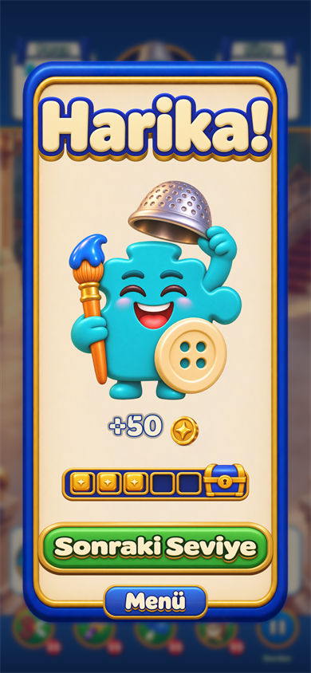
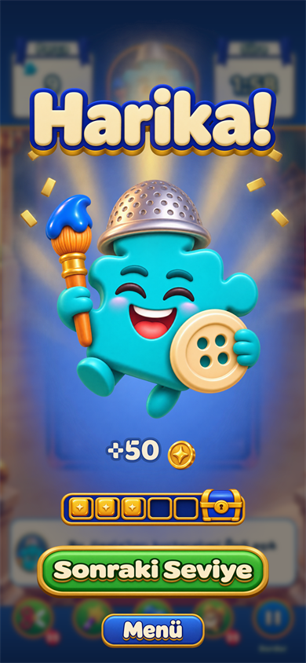
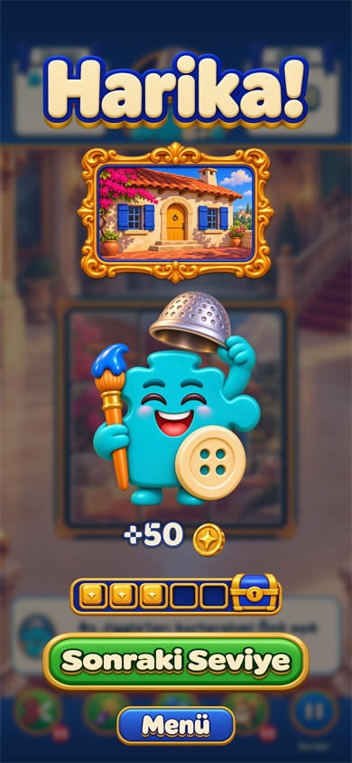
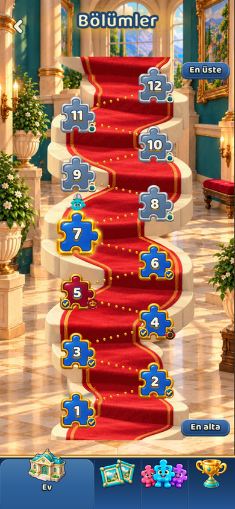

# T50 seçenekleri: kazanma ekranı ve harita düğmeleri (PM_72)

Zeyd, her öğe için bir harf seç (A, B ya da C). Oyuna henüz bağlanmadı; seçilen bağlanacak.

- Tarif: [CODEX_TASK50.md](../CODEX_TASK50.md)
- Codex `codex exec` ile iki ayrı çağrıda üretti, ilk denemede; yeniden deneme gerekmedi.
- Parçalar `Assets/Art/_yeni/T50/` altında: şeffaf PNG, @3x. Kazanma 30 dosya, harita 39 dosya.
- Önizlemeler 390×844 boyutunda, gerçek oyun görüntüsünün üstüne yerleştirildi.
- Şu anki ekranlar karşılaştırma için:
  - kazanma: [kazanma.png](../task29/pm72/once/kazanma.png)
  - harita: [harita.png](../task29/pm72/once/harita.png)

## Öğe 1: Kazanma ekranı

| A | B | C |
|---|---|---|
|  |  |  |
| Krem kart, kalın mavi çerçeve. Ortada selam veren Jigo. | Kart yok. Mavi ışık halesi, altın huzmeler ve konfeti. Zıplayan Jigo. | Üstte çerçevelenmiş, kurtarılan resim. Altında Jigo. |

Üç seçenekte de ortak öğeler:
- "Harika!" 3B başlık
- +50 sikke
- 5 bölmeli sandık çubuğu
- büyük yeşil "Sonraki Seviye" düğmesi ve küçük mavi "Menü"

Ayrıntı: [LISTE_kazanma.md](LISTE_kazanma.md)

## Öğe 2: Harita bölüm düğmeleri

| A | B | C |
|---|---|---|
|  |  |  |
| Düz madalyon, kalın 3B altın kenar. En sade seçenek. | Oymalı altın çerçeve, müze rozeti gibi. | Yapboz parçası biçimli düğme. |

Önizlemedeki durumlar:
- 1–6 tamamlandı (altın tik)
- 7 şu anki bölüm (1,25×, hale ve Jigo işareti)
- 8–12 kilitli (asma kilit)
- bir zor bölüm (bordo gövde, Kont mührü)
- bir engel dersi (engel rozeti)
- düğmeler arasında altın noktalı yol

Ayrıntı: [LISTE_harita.md](LISTE_harita.md)
